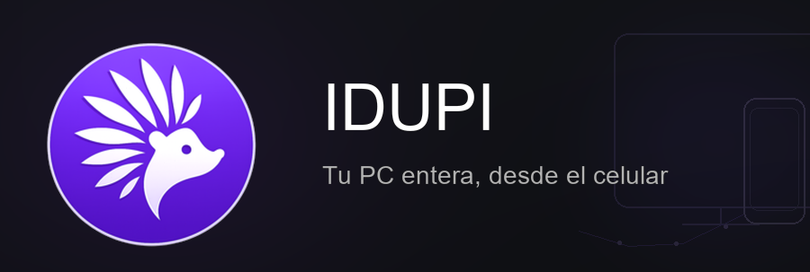
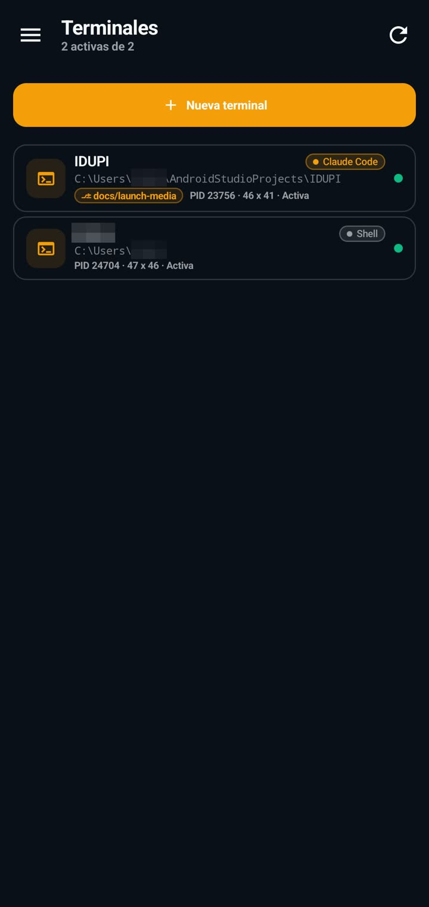
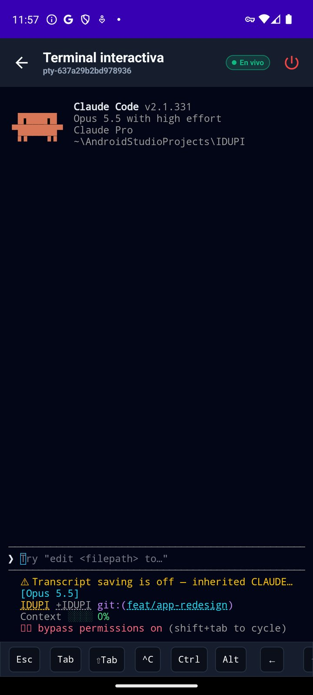
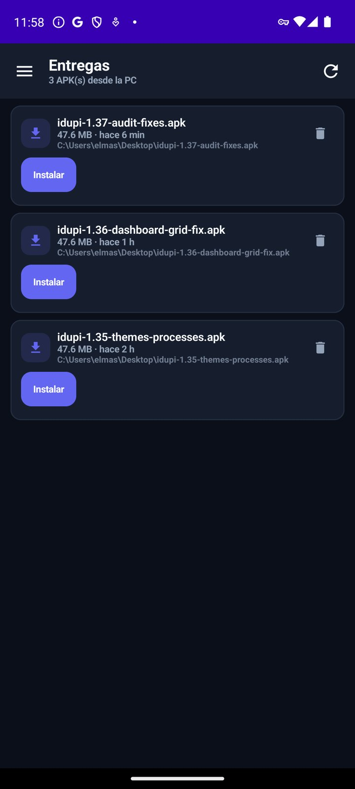
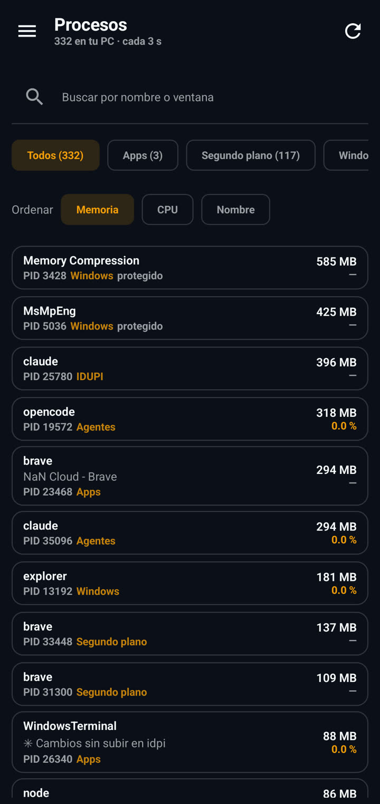
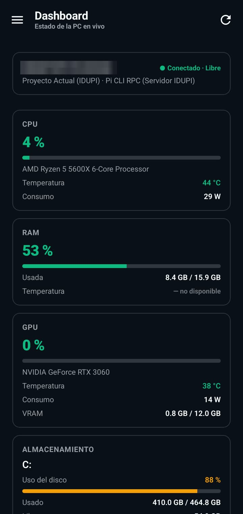
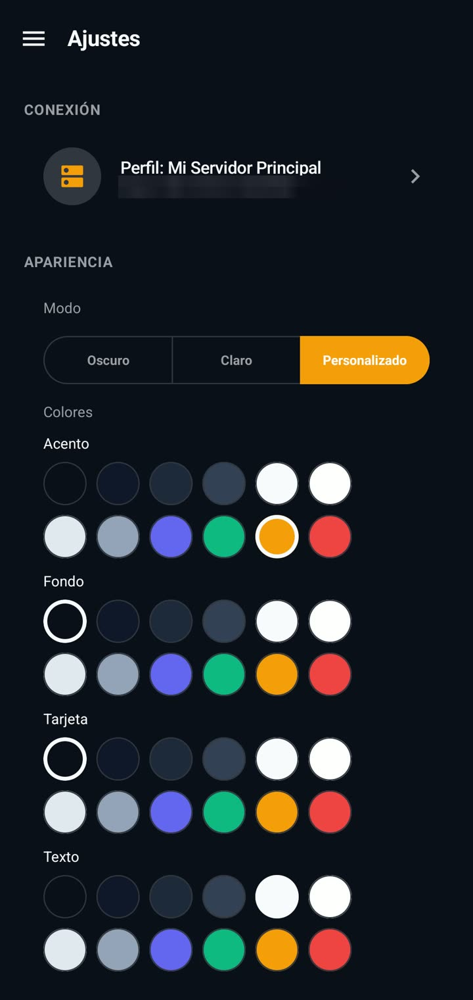

# IDUPI — Tu PC entera, desde el celular

[](https://github.com/Wladimirfn/idupi/releases/latest)



IDUPI es un servidor que se ejecuta en tu PC con Windows y una app Android que se conecta a él. Desde el teléfono puedes abrir **terminales reales** en la PC —Claude Code, OpenCode, Codex, PowerShell o cualquier TUI—, compartir esas mismas terminales con la PC en vivo, recibir e instalar APKs generados en la PC, revisar la salud del equipo, gestionar procesos y ver o controlar la pantalla.

Todo corre en tu hardware. IDUPI no usa servidores en la nube propios ni relay externo: el tráfico va de tu teléfono a tu PC por tu red local o por Tailscale. Si ejecutas agentes de IA dentro de una terminal, esos agentes se comunican con sus proveedores de modelos según su propia configuración.

En resumen:

- **Terminales interactivas** con PTY real y barra de teclas extra, pensadas para agentes de código.
- **Terminales compartidas**: la misma sesión en el teléfono, en el navegador de la PC y en `idupi-term`.
- **Entregas**: `idupi-push archivo.apk` en la PC → notificación en el teléfono → instalación con un toque.
- **Dashboard y Procesos**: CPU, RAM, GPU, temperaturas, potencia, discos y todos los procesos de la PC.

## 📸 Capturas

<p align="center">
  
  
  
  
  
  
</p>

## Requisitos

| # | Necesitas | Para qué |
|---|-----------|----------|
| 1 | Windows 10 u 11 | El servidor y el helper de pantalla/PTY solo existen para Windows |
| 2 | [Node.js](https://nodejs.org/) 20+ | Ejecuta el servidor (sin dependencias: no hay `npm install`) |
| 3 | [Go](https://go.dev/dl/) 1.21+ | Compila el helper de captura y PTY la primera vez, de forma automática |
| 4 | [Tailscale](https://tailscale.com/) (gratis), recomendado | Conecta teléfono y PC fuera de casa sin abrir puertos del router |
| 5 | Un teléfono Android | Donde corre la app |

## Puesta en marcha

### 1. Inicia el servidor (en la PC)

La forma recomendada es el script, que deja el servidor corriendo desacoplado de cualquier terminal:

```powershell
powershell -NoProfile -ExecutionPolicy Bypass -File idupi-server\scripts\start-server.ps1
```

También puedes iniciarlo en primer plano con:

```bash
node idupi-server/index.mjs
```

Al arrancar:

- Genera el **token de acceso** (64 caracteres) la primera vez y lo guarda en `.idupi-token`. En cada inicio muestra solo una versión enmascarada; para verlo completo en consola: `IDUPI_SHOW_TOKEN=1`.
- Muestra el **puerto**, `8788` por defecto (`PORT=9000 node idupi-server/index.mjs` para cambiarlo).
- Compila el helper `idupi-screen.exe` la primera vez que se usa la pantalla o una terminal.

Para que el servidor arranque solo al iniciar sesión en Windows:

```powershell
powershell -NoProfile -ExecutionPolicy Bypass -File idupi-server\scripts\install-autostart.ps1
```

Los logs quedan en `idupi-server/logs/`. Para detener y relanzar el servidor: `start-server.ps1 -Restart`.

> El control remoto de mouse y teclado viene activado. Si no lo quieres disponible: inicia el servidor con `IDUPI_REMOTE_INPUT=0`.

### 2. Instala la app

Descarga el APK publicado en **[GitHub Releases](https://github.com/Wladimirfn/idupi/releases/latest)** e instálalo en el teléfono. Si prefieres compilarlo, consulta [Compilar desde el código](#compilar-desde-el-código).

<!-- El QR apunta a releases/latest/download/IDUPI-ap.apk: sirve para cada release mientras el APK se publique con ese nombre. -->
<p align="center">
  <a href="https://github.com/Wladimirfn/idupi/releases/latest/download/IDUPI-ap.apk">
    
  </a>
  <br/>
  <em>Escanea para descargar IDUPI-ap.apk — com.idupi.app</em>
</p>

### 3. Conecta

En la app:

1. Elige el modo de conexión: **Tailscale VPN** si estás fuera de casa, **Local / LAN** si teléfono y PC comparten WiFi.
2. Host: la IP Tailscale (`100.x.y.z`) o la IP local de la PC (`192.168.x.x`).
3. Puerto: `8788`.
4. Pega el token completo de `.idupi-token` y pulsa **Conectar**.

### Verificación

- [ ] El servidor responde y el puerto `8788` está escuchando.
- [ ] La app muestra la pantalla **Terminales** después de conectar.
- [ ] Crear una terminal abre un shell y responde a lo que escribes.
- [ ] `idupi-push <archivo.apk>` en la PC hace llegar la notificación al teléfono.
- [ ] El **Dashboard** muestra métricas de la PC (las que el hardware exponga).

## La app, pantalla por pantalla

La app abre en **Terminales**; el resto de las pantallas se abren desde el menú lateral. El orden del menú es: Terminales, Entregas, Procesos, Dashboard, Proyectos, Alertas, Escritorio Remoto y Ajustes.

| Pantalla | Qué hace |
|----------|----------|
| **Terminales** | Lista las terminales PTY vivas, crea nuevas y abre una a pantalla completa. |
| **Entregas** | Muestra los APKs publicados desde la PC, con progreso de descarga e instalación. |
| **Procesos** | Lista todos los procesos de la PC con búsqueda, filtros y opción de finalizar. |
| **Dashboard** | Salud del PC en vivo: uso de CPU, RAM, GPU, temperaturas, potencia y discos. |
| **Proyectos** | Proyectos registrados en el servidor: activar, agregar y navegar archivos. |
| **Alertas** | Avisos del supervisor y solicitudes de aprobación o rechazo de planes. |
| **Escritorio Remoto** | Vista de la pantalla de la PC, trackpad, teclado, portapapeles y monitores. |
| **Ajustes** | Tema de la app y datos del perfil de conexión. |

### Terminales

Cada terminal es un PTY real en la PC (ConPTY), no una consola simulada. Eso permite ejecutar TUIs completos como Claude Code, OpenCode, Codex o `gentle-ai`, con colores y control de teclado.

- Barra de teclas extra: `Esc`, `Tab`, `⇧Tab`, `^C`, `Ctrl`, `Alt`, flechas, `PgUp`, `PgDn`, `Home`, `End` y símbolos frecuentes (`|`, `~`, `/`, `-`, `_`, `:`, `.`).
- Desplazamiento táctil con inercia.
- **Ancho**: fija la grilla en 80 columnas y permite desplazamiento horizontal, en lugar de reflow a las ~46 columnas que entran en vertical.
- `A-` / `A+`: tamaño de fuente de la terminal.
- Al cerrar una terminal se termina todo su árbol de procesos.

### Entregas

`idupi-push archivo.apk` en la PC registra el APK, lo copia a `idupi-server/deliveries/` y lo publica para el teléfono. La app muestra una notificación **"APK lista"**; al tocarla se descarga el archivo, se verifica su SHA-256 y se abre el instalador.

Android siempre pide confirmación para instalar apps de origen desconocido: la instalación con un toque no omite ese paso. Se conservan las 10 entregas más recientes.

### Dashboard

Métricas en vivo mientras la pantalla está visible:

- Uso de CPU y RAM; uso de GPU y VRAM mediante `nvidia-smi`.
- Temperatura y potencia de CPU y GPU cuando el hardware las expone.
- Almacenamiento por disco, con paginador para pasar de una unidad a otra.

Las lecturas que el hardware no expone se muestran como **"no disponible"**, nunca como números inventados. Para temperatura y potencia de CPU en Windows hace falta el [helper de sensores](#helper-de-sensores).

### Procesos

Lista todos los procesos del sistema, no solo los que administra el servidor. Incluye búsqueda, orden, detalle de memoria y CPU, y filtros por categoría: **Apps**, **Segundo plano**, **Windows**, **Agentes** e **IDUPI**. Finalizar un proceso pide confirmación y los procesos críticos del sistema están protegidos: el servidor responde con un error en lugar de terminarlos.

### Proyectos, Alertas y Escritorio Remoto

- **Proyectos**: lista, activación, alta y exploración de archivos de los proyectos registrados en el servidor.
- **Alertas**: avisos del supervisor con acciones para aprobar o rechazar planes.
- **Escritorio Remoto**: monitores, vista en vivo, trackpad, entrada de teclado, portapapeles y ajuste de calidad.

### Ajustes

- Tema **Oscuro**, **Claro** o **Personalizado**.
- Presets de acento **Índigo**, **Esmeralda** y **Ámbar**; el modo personalizado permite elegir colores propios y avisa si el contraste es bajo.
- Datos del perfil de conexión activo.

## Terminales compartidas con la PC

La misma terminal puede verse y usarse desde el teléfono y desde la PC al mismo tiempo, en ambas direcciones. Hay dos vistas en la PC:

### Vista web

Con el servidor corriendo, abre:

```
http://127.0.0.1:8788/terminal/
```

La página lista las terminales vivas, permite crear y cerrar, y transmite la salida en vivo. Solo acepta conexiones desde **loopback** (`127.0.0.1` / `::1`): desde la LAN o Tailscale responde `403`, porque la vista web es para la propia PC.

El token viaja en el fragmento de la URL (`#token=...`), que no se envía al servidor, y la página lo usa como `Authorization: Bearer` en las llamadas a la API.

### `idupi-term`

CLI para Windows Terminal que se conecta a la misma terminal que la app:

```
idupi-term                  Lista y conecta (crea una si no hay vivas)
idupi-term ls               Lista las terminales
idupi-term new [--cwd DIR]  Crea una terminal y se conecta
idupi-term attach <ref>     Conecta por id, prefijo o número
idupi-term web              Abre la vista web con el token
```

Dentro de una sesión conectada, `Ctrl+]` se desconecta sin cerrar la terminal.

Una terminal tiene un solo tamaño: el último cliente que se conecta o cambia de tamaño gana, como en tmux.

## Herramientas de PC

### `idupi-term`

Se instala con el repositorio en `idupi-server/bin/`. Requiere el servidor corriendo y lee el token de `.idupi-token` (o de `IDUPI_TOKEN`). El puerto se toma de `IDUPI_PORT`; el valor por defecto es `8788`, igual que el del servidor.

### `idupi-push`

```
idupi-push <archivo.apk>   Publica un APK para el teléfono
idupi-push ls              Lista las entregas publicadas
```

Debe apuntar a un archivo `.apk` existente y regular. El servidor calcula el SHA-256, guarda una copia en `idupi-server/deliveries/` y conserva las 10 entregas más recientes.

### Helper de sensores

La temperatura y la potencia de CPU en Windows no son accesibles para un usuario normal. El instalador registra una tarea programada elevada que escribe las lecturas cada dos segundos:

```powershell
powershell -NoProfile -ExecutionPolicy Bypass -File idupi-server\scripts\install-sensors-helper.ps1
```

El instalador descarga versiones fijadas de LibreHardwareMonitor (0.9.6) y del controlador PawnIO, verifica sus hashes y firmas, y copia el helper a `%ProgramData%\IDUPI` con permisos de administrador. Para desinstalarlo, ejecuta el mismo script con `-Uninstall`.

Detalles, hashes y proceso de actualización: [`idupi-server/docs/sensors.md`](idupi-server/docs/sensors.md).

## Seguridad

- **Token obligatorio**: todas las rutas de la API exigen `Authorization: Bearer <token>`. Sin token, el servidor responde `401`.
- **Vista web solo local**: `/terminal/` se rechaza desde direcciones que no sean loopback; no expone archivos ni terminales a la LAN.
- **Sin puertos abiertos**: usa Tailscale o la red local. No hagas port-forwarding del router hacia el servidor.
- **Token fuera de la app**: la WebView de la terminal recibe los bytes por HTTP desde Kotlin; el token nunca llega al JavaScript de la página.
- **Instalaciones verificadas**: las entregas se comprueban con SHA-256 antes de instalar; Android siempre pide confirmación para el sideload.
- **Procesos protegidos**: finalizar procesos críticos del sistema está bloqueado en el servidor.
- **Entrada remota opcional**: `IDUPI_REMOTE_INPUT=0` desactiva mouse y teclado remotos sin afectar la vista de pantalla.

Política de privacidad completa: [`PRIVACY.md`](PRIVACY.md).

## Compilar desde el código

### App Android

```bash
git clone https://github.com/Wladimirfn/idupi.git
cd idupi
gradlew :app:assembleDebug
```

El APK de debug queda en `app/build/outputs/apk/debug/`. Para una compilación de release, copia `keystore.properties.example` a `keystore.properties`, completa las credenciales de firma y ejecuta:

```bash
gradlew :app:assembleRelease
```

### Servidor

No tiene dependencias externas:

```bash
node idupi-server/index.mjs
```

Pruebas del servidor:

```bash
node --test idupi-server/test/*.test.mjs
```

### Helper de pantalla y PTY (Go)

El servidor lo compila solo al primer uso. Para compilarlo y probarlo aparte:

```bash
cd idupi-server/screen-helper
go build -ldflags=-s -w -o idupi-screen.exe .
go test ./...
```

### Pruebas de la app

```bash
gradlew :app:testDebugUnitTest
```

## Documentación

| Documento | Contenido |
|-----------|-----------|
| [`idupi-server/docs/README.md`](idupi-server/docs/README.md) | Rutas de la API, scripts del servidor y CLIs |
| [`idupi-server/docs/sensors.md`](idupi-server/docs/sensors.md) | Helper de sensores: instalación, hashes y actualización |
| [`docs/remote-screen-module.md`](docs/remote-screen-module.md) | Diseño del módulo de pantalla remota |
| [`PRIVACY.md`](PRIVACY.md) | Política de privacidad |

## Apoyá el proyecto

IDUPI es libre y gratis. Si te sirve y quieres colaborar con el mantenimiento, puedes invitarme un café:

**[paypal.me/wladimirfn](https://paypal.me/wladimirfn)** — cualquier suma suma.

## Licencia

[MIT](LICENSE) — libre para usar, modificar y distribuir. Si el proyecto te sirve, [un café se agradece](https://paypal.me/wladimirfn).
